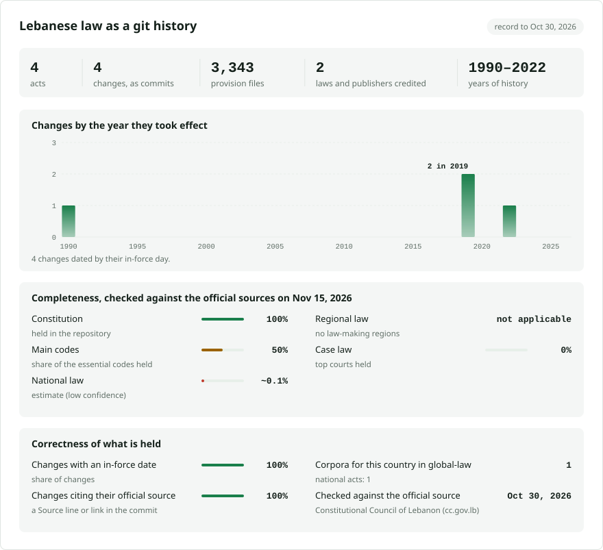

# Lebanon: law history in git

[العربية](README.md) · **English**

<picture>
<source media="(prefers-color-scheme: dark)" srcset="data/effort-dark.svg">

</picture>

The law of Lebanon as a git history: one file per provision, one commit per version on the day it took effect, and the act that made each change as the commit's author. `git blame` names the act behind every article; `git log` lists every change to an article; picking a date gives the text in force that day.

Part of [lexifina/global-law](https://github.com/lexifina/global-law), one git history for every country's law: this is Lebanon's national law, which global-law reads at `lebanon/national/acts/`.

**What is in it now:** the Constitution (102 articles) and three codes, each in one version: the Code of Obligations and Contracts (1,106 articles), the Land Commerce Code (711 articles, 44 of them added as bis) and the Penal Code (786 articles, 14 of them added later); with the preamble and headings, 3,339 provisions. No other law, regulation, treaty or court decision is here yet. Each act's `README.md` lists its provisions ([`constitution/README.md`](constitution/README.md)); [`REPRODUCE.md`](REPRODUCE.md) says how the files were made.

Each act is a folder with one file per provision: `constitution/art-001.md` is Article 1 (المادة 1) of the Constitution; the other acts are `obligations-and-contracts/`, `commerce/` and `penal-code/`.

The text is in Arabic, the official language (Constitution, art. 11), as the sources print it; the French text printed beside each article of the codes is not kept. An English translation is not part of this record.

## Questions as git commands

| Question | Command |
| --- | --- |
| Every change to Article 1 of the Constitution | `git log -p --word-diff -- constitution/art-001.md` |
| Which act wrote each line of Article 1? | `git blame constitution/art-001.md` |
| Every version of the Constitution, with the day each took effect | `git log --format="%h %(trailers:key=In-force,valueonly,separator=) %an" -- constitution ":^constitution/README.md"` |
| Article 1 as in force on 1 January 2026 | `python tools/on.py 2026-01-01 constitution art-001` |

**Outside git**, we also host this record publicly, for free:

- **[Ask Claude about Lebanese law](https://global-law.lexifina.com/v1/try_claude?country=lebanon)**: opens Claude with a first question ready.
- **[Ask ChatGPT](https://global-law.lexifina.com/v1/try_chatgpt?country=lebanon)**: the same question in ChatGPT.
- **[Search Lebanese law on our site](https://lexifina.com/law?country=lebanon&q=%D8%B9%D9%82%D8%AF+%D8%A7%D9%84%D8%A8%D9%8A%D8%B9)**: a search for "عقد البيع" (contract of sale), with each provision's text and its versions, no account needed.
- **[Developer REST API](https://global-law.lexifina.com/v1/search_law?query=%D8%B9%D9%82%D8%AF+%D8%A7%D9%84%D8%A8%D9%8A%D8%B9&jurisdiction=lebanon)**: the same search as JSON, with no key. See the [documentation here](https://lexifina.com/api/global-law).

Both assistants read the record through the free Global law connector (MCP, `https://global-law.lexifina.com/mcp`); the first time, the chat gives you the link that adds it. Ask in Arabic or in English.

**Host it yourself easily.** All it takes is git and Python, and the tools run on your machine:

```sh
git clone --depth 1 https://github.com/lexifina/global-law && cd global-law
python3 tools/countries.py add lebanon/national/acts
python3 tools/law.py show 2026-01-01 lebanon/national/acts/constitution/art-001.md
```

Opened in Claude Code, Cursor, VS Code or Codex, the clone also starts a local MCP server with the same tools ([MCP.md](https://github.com/lexifina/global-law/blob/main/MCP.md)).

## Dates

Each commit is dated at noon, Asia/Beirut, on the day the version took effect, and carries it in its `In-force:` trailer. Each act has one version, dated by the latest amendment its source names:

- the Constitution, 21 September 1990, the Constitutional Law that wrote the Taif Agreement into it (the Constitution was promulgated on 23 May 1926);
- the Code of Obligations and Contracts (1932) and the Land Commerce Code (1942), 1 July 2019, the day Law no. 126 of 29 March 2019 took effect (Official Gazette no. 18 of 1 April 2019, in force three months later);
- the Penal Code (1943), 13 January 2022, the Official Gazette date of Laws no. 256, 267 and 268 of 5 January 2022, taken to be in force on publication (not checked).

No version is credited to a law yet. Each is the "oldest version available", credited to its publisher, the Constitutional Council or the Lebanese University's Legal Informatics Center (`Kind: publisher`). The committer is Lexifina.

## How it is checked

- `tools/check_repo.py` reads every version back from git on the day it took effect and on the day before and compares it with the corpus, whose hash is in `data/corpus.sha256`; it also checks that every commit's trailers parse, that `main` has no merge commits and that no commit is dated in the future.
- `tools/build.py` writes the history from that one corpus file, and the same corpus gives the same commit hashes. [`REPRODUCE.md`](REPRODUCE.md) records that the checks were not yet run for this build and that no second build has been compared.
- `data/versions.json` gives each version's source address and sha256.
- [vulnerabilities/](vulnerabilities/README.en.md): possible drafting mistakes in this law, found by global-law's detectors and checked by hand. Not run yet.

## What it does not show

- **Amendment history.** Each act is one consolidated text, so the amendments made since 1926, 1932, 1942 and 1943 are in it but not as commits of their own, and no earlier text is here.
- **The amending laws' own texts**, and any amendment the Council's notes do not name (such as the 2004 amendment of art. 49) that its text does not reflect.
- **The French text** of the Constitution and the codes.
- **Gaps in the source.** Article 1106 of the Code of Obligations and Contracts is not in the Lebanese University's text and has no file; article 335 of the Penal Code is printed there twice with different texts, and both are kept.
- **Every other Lebanese law**, regulations, treaties and case law. None yet.

## Sources

| Source | Kind | Past versions | Notes |
| --- | --- | --- | --- |
| [Constitutional Council of Lebanon](https://www.cc.gov.lb) (المجلس الدستوري) | Official site: the Constitution, in Arabic | no, the current text | With notes naming each amending constitutional law; read on 29 October 2026 |
| [Legal Informatics Center of the Lebanese University](https://legiliban.ul.edu.lb) (المركز اللبناني للمعلوماتية القانونية) | The three codes, in Arabic and French | no, one consolidated text | With notes naming each amending law; Arabic kept; read on 30 October 2026 |

## Licence

See [`LICENSE`](LICENSE). Neither the Constitutional Council nor the Lebanese University states a licence for the legal texts; they are reproduced with attribution, their copyright status is not confirmed, and neither endorses this repository. Lexifina's history, commit messages, tables and tools are CC0 1.0.

No AI model wrote, translated or corrected legal text; the scripts were written by an AI model (see [`REPRODUCE.md`](REPRODUCE.md)).

## Visualisations

- [visualisations/](visualisations/README.en.md): charts drawn from this repository. Not drawn yet.

## More

From [lexifina/global-law](https://github.com/lexifina/global-law):

- [FEATURES.md](https://github.com/lexifina/global-law/blob/main/FEATURES.md): every feature, and what every corpus must support (`git blame`, `law.py`, the MCP tools)
- [FAQ.md](https://github.com/lexifina/global-law/blob/main/FAQ.md): questions and answers · [CONTRIBUTING.md](https://github.com/lexifina/global-law/blob/main/CONTRIBUTING.md): proposing changes · [MCP.md](https://github.com/lexifina/global-law/blob/main/MCP.md): the MCP server · [REPRODUCE.md](https://github.com/lexifina/global-law/blob/main/REPRODUCE.md): how it was built · [CHANGELOG.md](https://github.com/lexifina/global-law/blob/main/CHANGELOG.md)
- [FRESHNESS.md](https://github.com/lexifina/global-law/blob/main/FRESHNESS.md): how current each corpus is · [Monitoring](https://github.com/lexifina/global-law/tree/main/monitoring): whether updates are running · [WATCHING.md](https://github.com/lexifina/global-law/blob/main/WATCHING.md): how each official source is watched for changes
- [performance/](https://github.com/lexifina/global-law/tree/main/performance): how fast the tools are, measured
- [visualisations/](https://github.com/lexifina/global-law/tree/main/visualisations): charts and bridges across the world's law
- [Vulnerabilities](https://github.com/lexifina/global-law/tree/main/vulnerabilities): mistakes in legislation as published
