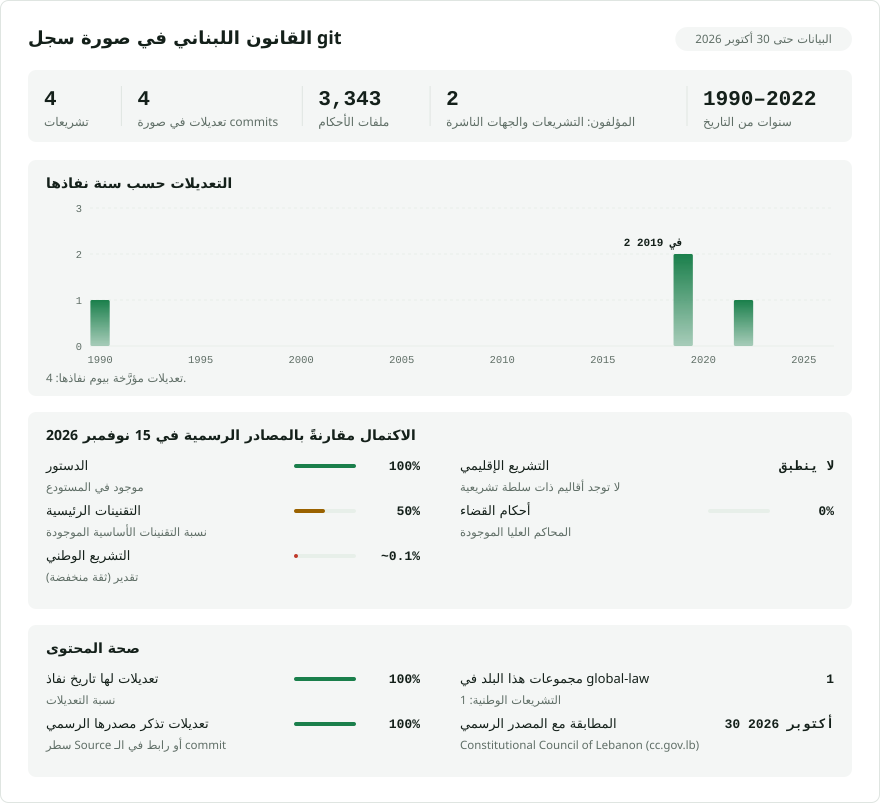

# لبنان: تاريخ القانون في git

**العربية** · [English](README.en.md)

<picture>
<source media="(prefers-color-scheme: dark)" srcset="data/ar/effort-dark.svg">

</picture>

القانون اللبناني في صورة سجل git: ملف لكل حكم، ولكل نسخة commit واحد في يوم نفاذها، والتشريع الذي أجرى كل تعديل هو مؤلف الـ commit. يبيّن `git blame` التشريع الذي يقف وراء كل مادة؛ ويسرد `git log` كل تعديل طرأ على مادة؛ واختيار تاريخ ما يعطي النص النافذ في ذلك اليوم.

جزء من [lexifina/global-law](https://github.com/lexifina/global-law)، وهو سجل git واحد لقانون كل بلد: هذا هو القانون الوطني اللبناني، الذي يقرؤه global-law في `lebanon/national/acts/`.

**المحتوى الحالي:** الدستور (102 مادة) وثلاثة قوانين أساسية، كل منها في نسخة واحدة: قانون الموجبات والعقود (1106 مواد)، وقانون التجارة البرية (711 مادة، منها 44 مادة أُضيفت مكررة) وقانون العقوبات (786 مادة، منها 14 مادة أُضيفت لاحقًا)؛ ومع الديباجة والعناوين، 3339 حكمًا. ولا يوجد هنا حتى الآن أي قانون أو نظام أو معاهدة أو قرار قضائي آخر. يسرد ملف `README.md` في كل تشريع أحكامه ([`constitution/README.md`](constitution/README.md))؛ ويبيّن [`REPRODUCE.md`](REPRODUCE.md) كيف أُعدّت الملفات.

كل تشريع مجلد، فيه ملف لكل حكم: `constitution/art-001.md` هي المادة 1 من الدستور؛ والتشريعات الأخرى هي `obligations-and-contracts/` و`commerce/` و`penal-code/`.

النص باللغة العربية، وهي اللغة الرسمية (الدستور، المادة 11)، كما تطبعه المصادر؛ ولا يُحتفظ بالنص الفرنسي المطبوع بجانب كل مادة من مواد القوانين. والترجمة الإنجليزية ليست جزءًا من هذا السجل.

## الأسئلة في صورة أوامر git

| السؤال | الأمر |
| --- | --- |
| كل تعديل طرأ على المادة 1 من الدستور | `git log -p --word-diff -- constitution/art-001.md` |
| أي تشريع كتب كل سطر من المادة 1؟ | `git blame constitution/art-001.md` |
| كل نسخ الدستور، مع يوم نفاذ كل منها | `git log --format="%h %(trailers:key=In-force,valueonly,separator=) %an" -- constitution ":^constitution/README.md"` |
| المادة 1 كما كانت نافذة في 1 كانون الثاني 2026 | `python tools/on.py 2026-01-01 constitution art-001` |

**خارج git**، نستضيف هذا السجل أيضًا للعموم، مجانًا:

- **[اسأل Claude عن القانون اللبناني](https://global-law.lexifina.com/v1/try_claude?country=lebanon)**: يفتح Claude ومعه سؤال أول جاهز.
- **[اسأل ChatGPT](https://global-law.lexifina.com/v1/try_chatgpt?country=lebanon)**: السؤال نفسه في ChatGPT.
- **[ابحث في القانون اللبناني على موقعنا](https://lexifina.com/law?country=lebanon&q=%D8%B9%D9%82%D8%AF+%D8%A7%D9%84%D8%A8%D9%8A%D8%B9)**: بحث عن "عقد البيع"، مع نص كل حكم ونسخه، دون الحاجة إلى حساب.
- **[واجهة REST API للمطوّرين](https://global-law.lexifina.com/v1/search_law?query=%D8%B9%D9%82%D8%AF+%D8%A7%D9%84%D8%A8%D9%8A%D8%B9&jurisdiction=lebanon)**: البحث نفسه بصيغة JSON، دون مفتاح. انظر [التوثيق هنا](https://lexifina.com/api/global-law).

يقرأ المساعدان كلاهما السجل عبر موصِّل Global law المجاني (MCP، `https://global-law.lexifina.com/mcp`)؛ وفي المرة الأولى تعطيك المحادثة الرابط الذي يضيفه. اسأل بالعربية أو بالإنجليزية.

**استضفه بنفسك بسهولة.** كل ما يلزم هو git وPython، والأدوات تعمل على جهازك:

```sh
git clone --depth 1 https://github.com/lexifina/global-law && cd global-law
python3 tools/countries.py add lebanon/national/acts
python3 tools/law.py show 2026-01-01 lebanon/national/acts/constitution/art-001.md
```

عند فتح النسخة المستنسخة في Claude Code أو Cursor أو VS Code أو Codex، تشغّل أيضًا خادم MCP محليًا بالأدوات نفسها ([MCP.md](https://github.com/lexifina/global-law/blob/main/MCP.md)).

## التواريخ

يحمل كل commit تاريخ الظهيرة، بتوقيت Asia/Beirut، من اليوم الذي نفذت فيه النسخة، ويحمل هذا اليوم في تذييله (trailer) `In-force:`. لكل تشريع نسخة واحدة، مؤرَّخة بآخر تعديل يذكره مصدرها:

- الدستور: 21 أيلول 1990، تاريخ القانون الدستوري الذي أدرج فيه اتفاق الطائف (صدر الدستور في 23 أيار 1926)؛
- قانون الموجبات والعقود (1932) وقانون التجارة البرية (1942): 1 تموز 2019، يوم نفاذ القانون رقم 126 الصادر في 29 آذار 2019 (الجريدة الرسمية، العدد 18 تاريخ 1 نيسان 2019، ويُعمل به بعد ثلاثة أشهر)؛
- قانون العقوبات (1943): 13 كانون الثاني 2022، تاريخ الجريدة الرسمية التي نُشرت فيها القوانين رقم 256 و267 و268 الصادرة في 5 كانون الثاني 2022، على افتراض نفاذها فور نشرها (لم يُتحقَّق من ذلك).

لا تُنسب أي نسخة إلى قانون حتى الآن. فكل نسخة هي "أقدم نسخة متاحة"، منسوبة إلى الجهة الناشرة لها، المجلس الدستوري أو مركز المعلوماتية القانونية في الجامعة اللبنانية (`Kind: publisher`). والمُودِع (committer) هو Lexifina.

## كيف يُتحقَّق منه

- يعيد `tools/check_repo.py` قراءة كل نسخة من git في يوم نفاذها وفي اليوم السابق له، ويقارنها بالمجموعة، التي توجد بصمتها (hash) في `data/corpus.sha256`؛ ويتحقق أيضًا من أن تذييلات كل commit قابلة للتحليل، وأن `main` خالٍ من commits الدمج، وأنه لا يوجد commit مؤرَّخ في المستقبل.
- يكتب `tools/build.py` السجل من ملف المجموعة الواحد هذا، والمجموعة نفسها تعطي بصمات الـ commits نفسها. ويسجّل [`REPRODUCE.md`](REPRODUCE.md) أن عمليات التحقق لم تُشغَّل بعد لهذا البناء وأنه لم تُقارَن به أي عملية بناء ثانية.
- يعطي `data/versions.json` عنوان مصدر كل نسخة وبصمة sha256 الخاصة بها.
- [vulnerabilities/](vulnerabilities/): أخطاء صياغة محتملة في هذا القانون، تكشفها أدوات global-law وتُراجَع يدويًا. لم تُشغَّل بعد.

## ما لا يُظهره

- **تاريخ التعديلات.** كل تشريع نص موحَّد واحد، فالتعديلات التي أُجريت منذ 1926 و1932 و1942 و1943 موجودة فيه ولكن ليس في commits مستقلة، ولا يوجد هنا أي نص سابق.
- **نصوص القوانين المعدِّلة نفسها**، وأي تعديل لا تذكره حواشي المجلس (مثل تعديل المادة 49 عام 2004) ولا يعكسه نصه.
- **النص الفرنسي** للدستور والقوانين.
- **الثغرات في المصدر.** المادة 1106 من قانون الموجبات والعقود غير موجودة في نص الجامعة اللبنانية وليس لها ملف؛ والمادة 335 من قانون العقوبات مطبوعة فيه مرتين بنصين مختلفين، واحتُفظ بكليهما.
- **كل القوانين اللبنانية الأخرى**، والأنظمة والمعاهدات والاجتهاد القضائي. لا يوجد أي منها حتى الآن.

## المصادر

| المصدر | النوع | النسخ السابقة | ملاحظات |
| --- | --- | --- | --- |
| [المجلس الدستوري اللبناني](https://www.cc.gov.lb) | الموقع الرسمي: الدستور، بالعربية | لا، النص الحالي | مع حواشٍ تذكر كل قانون دستوري معدِّل؛ قُرئ في 29 تشرين الأول 2026 |
| [المركز اللبناني للمعلوماتية القانونية في الجامعة اللبنانية](https://legiliban.ul.edu.lb) | القوانين الثلاثة، بالعربية والفرنسية | لا، نص موحَّد واحد | مع حواشٍ تذكر كل قانون معدِّل؛ احتُفظ بالعربية؛ قُرئ في 30 تشرين الأول 2026 |

## الترخيص

انظر [`LICENSE`](LICENSE). لا يذكر المجلس الدستوري ولا الجامعة اللبنانية أي ترخيص للنصوص القانونية؛ وهي منقولة مع نسبتها إلى مصدرها، ووضعها من حيث حق المؤلف غير مؤكد، ولا يتبنى أيٌّ منهما هذا المستودع. أما سجل Lexifina ورسائل الـ commits والجداول والأدوات فهي بموجب CC0 1.0.

لم يكتب أي نموذج ذكاء اصطناعي نصًا قانونيًا ولم يترجمه ولم يصححه؛ أما البرامج النصية (scripts) فكتبها نموذج ذكاء اصطناعي (انظر [`REPRODUCE.md`](REPRODUCE.md)).

هذا النص ترجمة للنسخة الإنجليزية ([README.en.md](README.en.md))؛ وعند الاختلاف تسود النسخة الإنجليزية.

## الرسوم البيانية

- [visualisations/](visualisations/): رسوم بيانية مستخرجة من هذا المستودع. لم تُرسم بعد.

## المزيد

من مستودع [lexifina/global-law](https://github.com/lexifina/global-law) (صفحات باللغة الإنجليزية):

- [FEATURES.md](https://github.com/lexifina/global-law/blob/main/FEATURES.md): جميع الميزات، وما يجب أن تدعمه كل مجموعة (`git blame`، `law.py`، أدوات MCP)
- [FAQ.md](https://github.com/lexifina/global-law/blob/main/FAQ.md): أسئلة وأجوبة · [CONTRIBUTING.md](https://github.com/lexifina/global-law/blob/main/CONTRIBUTING.md): اقتراح تغييرات · [MCP.md](https://github.com/lexifina/global-law/blob/main/MCP.md): خادم MCP · [REPRODUCE.md](https://github.com/lexifina/global-law/blob/main/REPRODUCE.md): طريقة البناء · [CHANGELOG.md](https://github.com/lexifina/global-law/blob/main/CHANGELOG.md)
- [FRESHNESS.md](https://github.com/lexifina/global-law/blob/main/FRESHNESS.md): مدى حداثة كل مجموعة · [المراقبة](https://github.com/lexifina/global-law/tree/main/monitoring): هل تعمل التحديثات · [WATCHING.md](https://github.com/lexifina/global-law/blob/main/WATCHING.md): كيف يُراقَب كل مصدر رسمي لرصد التغييرات
- [performance/](https://github.com/lexifina/global-law/tree/main/performance): سرعة الأدوات كما قيست
- [visualisations/](https://github.com/lexifina/global-law/tree/main/visualisations): رسوم بيانية وروابط عبر قوانين العالم
- [الثغرات](https://github.com/lexifina/global-law/tree/main/vulnerabilities): أخطاء في التشريعات كما نُشرت
